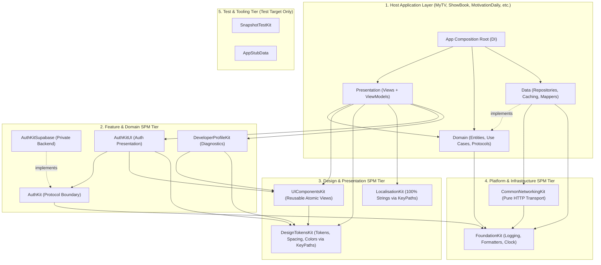

# Ecosystem Architectural Governance Specification
## Standard for All Swift Packages (SPMs) and Host Applications

---

## 1. Architectural Philosophy & Dependency Hierarchy

Every project in the ecosystem follows a strict **layered, unidirectional dependency architecture**. No component may violate this hierarchy.



---

## 2. KeyPath-Driven SwiftUI Ergonomics (Mandatory Ecosystem Pattern)

To achieve maximum expressiveness, eliminate verbose namespaces, and ban hardcoded constants, **all consumer Views must interact with Tokens and Localization via Swift KeyPaths (`\.property`)**.

### Comparison: Verbose / Anti-Pattern vs. Mandatory KeyPath Syntax

| Component | Anti-Pattern (Banned) | Verbose Namespaced (Discouraged) | **Mandatory Standard (KeyPath Syntax)** |
| :--- | :--- | :--- | :--- |
| **Localised Text** | `Text("Sign In")` | `Text(LocalisationKit.Strings.Auth.signIn)` | `Text(\.signIn)` or `Text(\.auth.signIn)` |
| **Padding / Spacing** | `.padding(16)` | `.padding(DesignTokens.Spacing.medium)` | `.padding(\.medium)` or `.padding(\.s16)` |
| **Edge Padding** | `.padding(.horizontal, 8)` | `.padding(.horizontal, DesignTokens.Spacing.s8)` | `.padding(.horizontal, \.s8)` |
| **Colors** | `.foregroundColor(.blue)` | `.foregroundColor(DesignTokens.Colors.brandPrimary)` | `.foregroundStyle(\.brandPrimary)` or `.foregroundColor(\.brandPrimary)` |
| **Backgrounds** | `.background(Color(hex: "#1A1A1A"))` | `.background(BrandPalette.current.surface)` | `.background(\.surface)` |
| **Corner Radius** | `.cornerRadius(12)` | `.cornerRadius(LayoutPreset.cardRadius)` | `.cornerRadius(\.cardRadius)` or `.cornerRadius(\.r12)` |
| **Typography** | `.font(.system(size: 18, weight: .bold))` | `.font(DesignTokens.Typography.titleMedium)` | `.font(\.titleMedium)` |

---

## 3. Dedicated Rules per SPM

### 3.1. `LocalisationKit`
*The authoritative, single source of truth for all user-facing strings across the entire ecosystem.*

* **KeyPath First API**:
  `LocalisationKit` must vend SwiftUI `View` and `Text` initializers that resolve directly via KeyPaths:
  ```swift
  // Mandatory Developer Usage:
  Text(\.signIn)
  Text(\.forgotPassword)
  Text(\.welcome, arguments: [user.name])
  Button(titleKeyPath: \.createAccount) { ... }
  ```
* **Zero Raw Strings Rule**: No host application or SPM may ever hardcode user-facing string literals. Every string must be registered in `LocalisationKit`.
* **100% Code Coverage Mandate**:
  - Exactly **100.0% line and branch coverage** enforced in CI.
  - Comprehensive unit tests must verify:
    1. Every KeyPath resolves to a valid, non-empty localized value.
    2. Zero missing translations across all supported locales (`en`, `ar`, `fr`, etc.).
    3. Pluralization rules and argument interpolations pass with boundary test cases.
* **SwiftLint Zero Tolerance**: Zero warnings and zero errors allowed.

---

### 3.2. `DesignTokensKit`
*The system-wide visual token contract for colors, spacing, typography, and geometry.*

* **KeyPath Extensions for SwiftUI**:
  `DesignTokensKit` must implement View extensions that accept KeyPaths for layout and styling:
  ```swift
  // Spacing & Padding
  view.padding(\.medium)
  view.padding(.horizontal, \.s16)
  view.padding(.vertical, \.s8)

  // Colors & Brand
  view.foregroundStyle(\.brandPrimary)
  view.background(\.surface)
  view.tint(\.action)

  // Geometry & Radii
  view.cornerRadius(\.cardRadius)
  view.clipShape(RoundedRectangle(cornerRadius: \.r12))
  ```
* **No Hardcoded Magic Numbers**: All spacing (`s2`, `s4`, `s8`, `s12`, `s16`, `s24`, `s32`, etc.), radii, borders, and opacities must be accessed via tokens.
* **No Business or Network Logic**: Contains only design primitives and SwiftUI style modifiers.
* **Theme Switching**: Seamless support for runtime dynamic palettes (`BrandPalette`, high-contrast, dark/light mode).

---

### 3.3. `AuthKit` (`AuthKit`, `AuthKitSupabase`, `AuthKitUI`)
*Decoupled authentication boundary encapsulating identity providers.*

* **Strict Multi-Target Separation**:
  - `AuthKit`: Pure public protocols (`AuthBackend`, `SessionManaging`), public models (`AuthUser`, `AuthSessionEvent`), and domain errors.
  - `AuthKitSupabase`: Internal backend adapter implementing `AuthBackend` via `supabase-swift`.
  - `AuthKitUI`: Presentation components (`AuthView`, `ProviderSignInButton`, `AppAuthGate`).
* **Zero Leakage of Sensitive Data & SDK Types**:
  - Supabase client objects (`SupabaseClient`), private API keys, Anon tokens, project URLs, and SDK-specific types must **NEVER** be leaked across module boundaries.
  - Host apps and other SPMs must **NEVER** import `Supabase` directly.
* **Keychain Isolation**: Authentication tokens (JWT, refresh tokens) must be saved exclusively in encrypted Keychain items with `kSecAccessControl` device-unlocked protection.
* **Pluggable Architecture**: Swapping `AuthKitSupabase` with a mock or other backend provider requires zero code changes in host applications.

---

### 3.4. `UIComponentsKit`
*The shared atomic and molecular UI component library.*

* **Responsibilities**:
  - Reusable buttons, cards, list tiles, overlays, loading indicators, empty states, and standard menus.
* **Strict Invariants**:
  - **100% Token-Driven**: All dimensions, colors, and typography must originate from `DesignTokensKit` via KeyPaths.
  - **Stateless & Decoupled**: Components are pure presentation primitives driven by state or ViewModels. No direct networking or database queries.
  - **Previews & Snapshot Tests**: Every component must supply SwiftUI Previews (Light, Dark, and Dynamic Type modes) and snapshot test baselines.

---

### 3.5. `CommonNetworkingKit`
*Pure, domain-agnostic HTTP/REST transport engine.*

* **Responsibilities**:
  - Native `URLSession` execution, async/await interface, generic JSON decoding.
  - RFC-compliant HTTP status validation (2xx success vs. 4xx/5xx mapped errors).
  - Automatic retry policy with jittered exponential backoff.
  - Privacy-preserving HTTP logging (scrubbing sensitive headers such as `Authorization` and `Cookie`).
* **Strict Invariants**:
  - **Zero Domain Knowledge**: Must have no knowledge of app-specific models (e.g., Books, Movies, Quotes, User Profiles).
  - **Zero UI Dependencies**: Pure `Foundation` only. No `SwiftUI`, `UIKit`, or `AppKit`.

---

### 3.6. `FoundationKit`
*Cross-cutting platform infrastructure.*

* **Responsibilities**:
  - Unified structured logging (`UnifiedLogger`, `AppLogger`).
  - Formatting factories (`DateFormatterFactory`, `NumberFormatterFactory`).
  - Concurrency abstractions (`Clock`, `MainQueueDispatching`).
  - Feature flags and runtime configuration primitives.
* **Strict Invariants**:
  - Pure Foundation and Swift standard library. Zero UI or network dependencies.
  - All utilities must support dependency injection for deterministic testing.

---

### 3.7. `SnapshotTestKit` & `AppStubData`
*Test support and mock infrastructure.*

* **Strict Invariants**:
  - **Test Target Only**: Must never be linked into any Release or Production application binary.
  - **Deterministic Mocks**: `AppStubData` supplies static, immutable JSON payloads and mock repositories for UI Previews, unit tests, and snapshot tests.

---

### 3.8. `DeveloperProfileKit`
*Developer diagnostics and settings interface.*

* **Responsibilities**:
  - Environment switching (Production, Staging, Local/Mock).
  - Diagnostic logs viewer, network inspector, cache clearers.
* **Strict Invariants**:
  - Self-contained UI and logic.
  - Must be stripped or protected behind compiler flags (`#if DEBUG`) in release builds.

---

## 4. Universal Host Project Governance (MyTV, ShowBook, MotivationDaily, and all Future Apps)

All host applications must adhere to the **Clean Architecture + MVVM** paradigm.

### 4.1. Clean Architecture Layer Isolation

```
HostApp/
├── Domain/         # Entities, Repository Interfaces, UseCases (POCO Swift)
├── Data/           # Repository Impls, Data Sources, Mappers, Cache, Network
├── Presentation/   # Screens, ViewModels, Components, Coordinators/Navigation
└── App/            # Composition Root (AppDI / AppContainer), App Lifecycle
```

#### Layer Rules:
1. **Domain Layer**:
   - Contains pure business rules: `Entities`, `UseCases`, `Repository Interfaces`, and `Domain Errors`.
   - **Allowed**: `Foundation`.
   - **Strictly Banned**: `SwiftUI`, `UIKit`, `Data` layer types, `CommonNetworkingKit`, third-party vendor SDKs.
2. **Data Layer**:
   - Implements Domain repository protocols. Fetches from Network/Cache and maps DTOs to Domain Entities.
   - **Allowed**: `Domain`, `CommonNetworkingKit`, `FoundationKit`.
   - **Strictly Banned**: `SwiftUI`, `UIKit`, `Presentation` layer types.
3. **Presentation Layer**:
   - Contains SwiftUI views, ViewModels, navigation routers.
   - **Allowed**: `Domain` (Use Cases/Entities), `DesignTokensKit` (via KeyPaths), `UIComponentsKit`, `LocalisationKit` (via KeyPaths).
   - **Strictly Banned**: Direct calls to `Data` layer, `CommonNetworkingKit`, or network services. Views observe ViewModels; ViewModels call Use Cases.
4. **App Layer (Composition Root)**:
   - Wires concrete implementations (`Data`, `AuthKitSupabase`) to Domain interfaces and injects them into ViewModels.
   - The **only** place allowed to assemble concrete dependencies.

---

### 4.2. Host Project Invariants (The "Zero" Rules)

| Invariant | Prohibited Anti-Pattern | Required Mandate (KeyPath Driven) |
| :--- | :--- | :--- |
| **Zero Raw Strings** | `Text("Sign In")` | `Text(\.signIn)` |
| **Zero Magic Layout Numbers** | `.padding(16)` or `.padding(.horizontal, 8)` | `.padding(\.medium)` or `.padding(.horizontal, \.s8)` |
| **Zero Hardcoded Radii** | `.cornerRadius(12)` | `.cornerRadius(\.cardRadius)` or `.cornerRadius(\.r12)` |
| **Zero Hardcoded Colors** | `Color(hex: "#1A1A1A")` or `.blue` | `.foregroundStyle(\.brandPrimary)` or `.background(\.surface)` |
| **Zero Direct Auth SDKs** | `import Supabase` in Host App | `import AuthKit` and consume `SessionManaging` |
| **Zero Ad-Hoc Network Calls** | Custom `URLSession.shared.dataTask` | Route through `CommonNetworkingKit` via Data layer |
| **Zero In-House Duplicate UI** | Re-implementing loading spinners, standard buttons, or dialogs in host app | Consume `UIComponentsKit` |
| **Zero Direct ViewModel Network Calls** | ViewModel calling API directly | ViewModel invokes Domain `UseCase` |

---

## 5. Automated CI/CD Enforcement & Quality Gates

### 5.1. Custom SwiftLint Rules (`.swiftlint.yml`)
Add these custom rules across all Host Projects and SPMs to automatically block regressions at build and PR time:

```yaml
custom_rules:
  # 1. Ban raw strings in Views (mandates KeyPath or L10n)
  ban_hardcoded_view_strings:
    name: "Hardcoded String in View"
    regex: 'Text\(\s*"[^"]+"\s*\)'
    message: "Hardcoded strings are forbidden. Use Text(\\.keyPath) with LocalisationKit."
    severity: error
    included: ".*/Presentation/.*"

  # 2. Ban magic padding literals (mandates KeyPath: .padding(\.medium) or .padding(\.s8))
  ban_hardcoded_padding:
    name: "Hardcoded Padding Literal"
    regex: '\.padding\(\s*((\.[a-zA-Z]+,\s*)?[0-9]+(\.[0-9]+)?)\s*\)'
    message: "Magic padding values are forbidden. Use .padding(\\.medium) or .padding(\\.s8)."
    severity: error
    included: ".*/Presentation/.*"

  # 3. Ban magic corner radius literals (mandates KeyPath: .cornerRadius(\.cardRadius))
  ban_hardcoded_corner_radius:
    name: "Hardcoded Corner Radius"
    regex: '\.cornerRadius\(\s*[0-9]+(\.[0-9]+)?\s*\)'
    message: "Magic corner radii are forbidden. Use .cornerRadius(\\.cardRadius) or .cornerRadius(\\.r12)."
    severity: error
    included: ".*/Presentation/.*"

  # 4. Ban direct Supabase import in host apps
  ban_direct_supabase_import:
    name: "Direct Supabase Import Banned"
    regex: 'import\s+Supabase'
    message: "Direct Supabase import is banned. Use AuthKit instead."
    severity: error
    excluded: ".*/AuthKitSupabase/.*"

  # 5. Ban UI imports in Domain & Data
  ban_ui_in_domain_and_data:
    name: "UI Framework in Domain or Data"
    regex: 'import\s+(SwiftUI|UIKit|AppKit)'
    message: "Domain and Data layers must never import UI frameworks."
    severity: error
    included:
      - ".*/Domain/.*"
      - ".*/Data/.*"
```

---

### 5.2. Minimum Code Coverage Thresholds (Blocking PR Gates)

| Project / Module | Minimum Line Coverage | Blocking Enforcement |
| :--- | :---: | :---: |
| **`LocalisationKit`** | **100.0%** | Strict CI Gate |
| **`AuthKit` & `AuthKitSupabase`** | **95.0%** | Strict CI Gate |
| **`CommonNetworkingKit`** | **95.0%** | Strict CI Gate |
| **`FoundationKit`** | **90.0%** | Strict CI Gate |
| **`DesignTokensKit`** | **90.0%** | Strict CI Gate |
| **`UIComponentsKit`** | **85.0%** + Snapshots | Strict CI Gate |
| **Host Apps: `Domain` & `Data`** | **85.0%** | Strict CI Gate |
| **Host Apps: `Presentation` (ViewModels)** | **80.0%** | Strict CI Gate |

---

### 5.3. Pull Request Automated Verification Matrix

Every pull request across the ecosystem must pass this automated pipeline before merging:

1. **Static Analysis & Linting**: `swiftlint --strict` (0 warnings, 0 errors).
2. **Architecture Boundary Check**: Verify forbidden imports (no UI in Domain/Data, no Supabase in Host).
3. **KeyPath Syntax Compliance**: Verify UI views use `Text(\.key)`, `.padding(\.spacing)`, and `\.color`.
4. **Unit Tests & Code Coverage**: Execute test suites with coverage validation against the thresholds above.
5. **Snapshot Regressions**: Run `SnapshotTestKit` tests to catch visual discrepancies.
6. **Swift 6 Concurrency Audit**: Verify zero data-race warnings under `-strict-concurrency=complete`.
