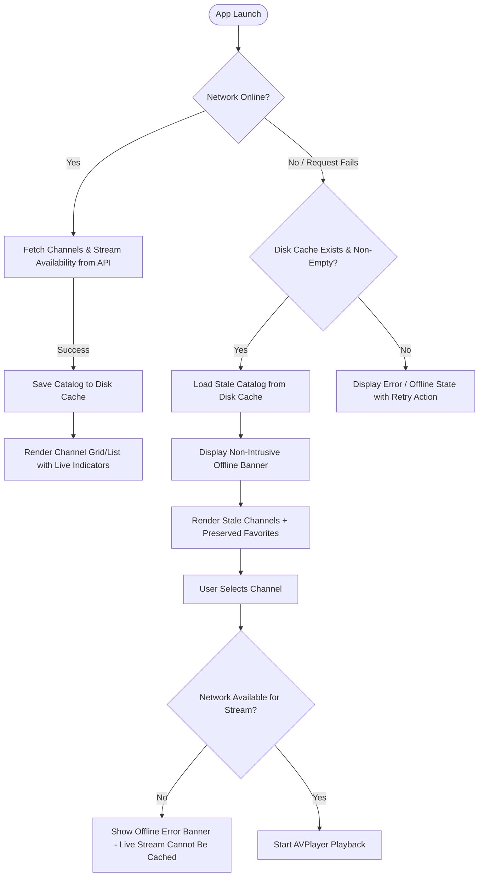

# ADR 001: Offline Launch, Stale Cache Fallback, and Content Limitations

## Status
Accepted

## Context
MyTV delivers live IPTV streams categorized by region, country, and genre. Live streaming applications face real-world connectivity challenges:
1. Cold launch in airplane mode, subway transit, or poor cellular conditions.
2. Intermittent disconnections during channel browsing and stream discovery.
3. Content and provider limitations where live stream playlists (`.m3u8`) cannot be cached locally due to ephemeral token expirations, DRM, and dynamic ad-insertion tokens.
4. User favorites stored locally must remain resilient and accessible regardless of network state or catalog cache wipes.

## Decision

### 1. Catalog Tiering and Disk Caching
- **Primary Source**: `IPTVAPIService` fetches live channel metadata, logos, and global stream availability asynchronously.
- **Disk Cache Storage**: Successful responses populate `ChannelDiskCache` stored at `Library/Caches/channels_cache.json`.
- **Atomic Operations**: Cache writes use atomic file replacement (`.atomic`) to prevent cache corruption during mid-write app termination.
- **Offline / Stale Fallback**: When network requests throw connectivity errors (`URLError.notConnectedToInternet`, timed out, network connection lost) or unhandled API failure, `ChannelRepositoryImpl` falls back to reading `ChannelDiskCache`. If cached entries exist, they are decoded and presented seamlessly with a `showOfflineBanner = true` visual indicator rather than blocking the UI with a full-screen blocking error.

### 2. Independent Favorites Persistence
- Favorites are stored via `FavoriteChannelStore` in `UserDefaults` (`favoriteChannelIDs`), separate from the ephemeral channel metadata cache.
- Wiping the channel cache (`clearCache()`) clears `channels_cache.json` and in-memory caches, but preserves the user's curated favorites list.
- When launching offline, favorited channels are matched against cached channel metadata so the user can still filter and see their favorite stations.

### 3. Stream & Content Limitations
- **Live Streams**: Stream URLs (`.m3u8`) are network-only and are intentionally not cached on disk. Live IPTV streams carry dynamic tokens and changing origin servers; playing a cached stream URL days or weeks later would produce silent stalls or broken playback.
- **Logos & Images**: Logos are handled via `DefaultImageCache` with an in-memory NSCache and disk backing. In offline mode without prior cached images, standard SF Symbol fallbacks (`tv.circle.fill`) ensure zero visual breakage.
- **Offline Stream Attempts**: When offline, attempting to load or play a stream presents an explicit offline banner or user-friendly error banner (`The media playback failed to start.` or offline state), preventing infinite spinner loops or zombie network threads.

## User Flow Diagram

## Consequences
- **Positive**: App launches reliably even with zero network connectivity. Users can browse existing channels and access their favorited station list.
- **Negative / Trade-offs**: Live video playback requires active internet connectivity; users cannot play cached video offline. Cached channel listings may temporarily show decommissioned channels until internet connection resumes and a catalog refresh occurs.
