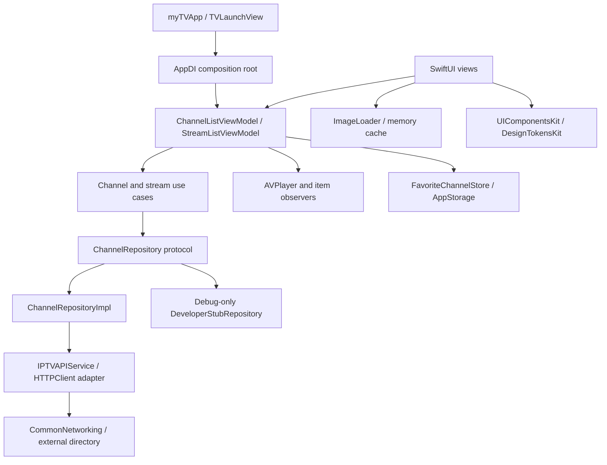

# MyTV

**A SwiftUI IPTV browser focused on reactive catalog state, explicit service boundaries, and AVPlayer lifecycle correctness.**

Built by [Anurag Chourasia](https://github.com/Anurag-Chourasia), iOS Engineer. MyTV browses external channel metadata, filters and groups large catalogs, persists favorites, lists available streams, and plays provider-hosted media through AVPlayer.

The repository is a portfolio and engineering reference. It distinguishes implemented behavior, tested contracts, and planned reliability work rather than claiming production readiness from architecture labels alone.

## Engineering highlights

| Engineering decision | Why it matters | Implementation evidence |
|---|---|---|
| Compose services and repositories at the app boundary | Views do not construct HTTP requests; live/stub implementations can change without rewriting the UI | [AppDI](myTV/App/AppDI.swift), [ChannelRepository](myTV/Domain/Repositories/ChannelRepository.swift) |
| Derive the visible catalog from a Combine pipeline | Search, scope, countries, categories, availability, grouping, and sorting compose into one result | [ChannelListViewModel](myTV/Presentation/Screens/ChannelList/ChannelListViewModel.swift) |
| Model stream availability as true / false / unknown | A failed lookup must not falsely label every channel unavailable | [Channel model](myTV/Domain/Entities/Channel.swift), [repository](myTV/Data/Repositories/ChannelRepositoryImpl.swift), [availability tests](TestSupport/run-channel-availability-tests.py) |
| Validate player/item identity inside callbacks | Queued failures from an old or dismissed player must not restart playback or advance a replacement session | [StreamListViewModel](myTV/Presentation/Screens/StreamList/StreamListViewModel.swift), [playback tests](TestSupport/PlaybackTests/PlaybackTests.swift) |
| Persist favorites independently of downloaded metadata | Cache clearing and app relaunch do not erase the user's saved channel IDs | [FavoriteChannelStore](myTV/Data/Cache/FavoriteChannelStore.swift), [persistence tests](TestSupport/run-favorites-tests.py) |
| Verify dependency pins and actor boundaries | Make upgrades and concurrency assumptions explicit and reviewable | [dependency record](Scripts/dependencies.json), [compiler probe](TestSupport/check-actor-boundary.sh) |

## User experience

1. **Browse channels** in list or grid, with All Channels/Favorites scope and debounced search.
2. **Refine the catalog** through the hamburger menu: group by name, country, or category; sort sections and channels independently; choose country/category filters.
3. **Avoid known empty destinations.** Tiles show **No streams available** when the directory contains no matching stream. **Filter → Hide channels without streams** hides those tiles, displays a tick when enabled, and resets with Clear Filters. Unknown availability remains visible.
4. **Open a channel** to see its stream choices and quality metadata. Selecting a stream prepares AVPlayer and opens a player sheet when ready; observed failures can advance to subsequent stream candidates.
5. **Save favorites** across launches. Hold a logo to preview it and use the native share sheet for Photos, Files, or compatible installed apps.
6. **Adjust appearance/accessibility.** System/Light/Dark choices apply across screens and sheets. Accessibility text sizes resolve grid to list with explanatory alerts. Profile, logo-preview, and player sheets use cross icons to close.

Selected filters have checkmarks; destructive clearing actions are separated. Skeletons, empty results, retry states, preparation overlays, and offline banners communicate different conditions. A directory entry is not a guarantee that a stream currently plays.

## Architecture

MyTV uses **SwiftUI + MVVM with repository and use-case boundaries**. `AppDI` is the composition root. The Domain folder holds entities/repository contracts; concrete use cases currently live under Data. Presentation view models receive concrete use-case wrappers backed by repository protocols.

This is pragmatic layering rather than a claim of complete framework independence: for example, `Channel.swift` imports SwiftUI and several UI dependencies still come from `AppDI.shared`.



### Ownership and source map

| Area | Responsibility / starting point |
|---|---|
| Composition | [AppDI](myTV/App/AppDI.swift) chooses repository implementations and constructs feature view models |
| Channel presentation | [ChannelListViewModel](myTV/Presentation/Screens/ChannelList/ChannelListViewModel.swift) owns catalog state, derived grouping/filtering, favorites, alerts, and accessibility layout decisions |
| Data integration | [ChannelRepositoryImpl](myTV/Data/Repositories/ChannelRepositoryImpl.swift) joins channels/logos and computes stream availability; [IPTVAPIService](myTV/Data/Network/Services/IPTVAPIService.swift) owns endpoint calls |
| Playback lifecycle | [StreamListViewModel](myTV/Presentation/Screens/StreamList/StreamListViewModel.swift) owns candidate selection, preparation, observers, fallback, and teardown; the player view presents AVPlayer |
| Images | [ImageLoader](myTV/Core/ImageCaching/ImageLoader.swift) checks memory cache, validates HTTP/image data, then publishes success/failure; [ChannelLogo](myTV/Presentation/Components/Channel/ChannelLogo.swift) supplies preview/sharing |
| Preferences | [FavoriteChannelStore](myTV/Data/Cache/FavoriteChannelStore.swift) persists stable IDs; AppStorage stores layout/grouping/sort/appearance preferences |
| Environment services | Core contains reachability, haptics, display-name mapping, and image-cache abstractions |
| Developer controls | [DeveloperSettingsView](myTV/Developer/DeveloperSettingsView.swift) owns Debug launch/shake presentation; [AppRuntime](myTV/Developer/AppRuntime.swift) defines flags, overrides, and fixture repository |

### Catalog data flow

Channel loading starts channel, logo, and stream-directory requests concurrently. Logos are matched by normalized channel ID and ranked by supported format and resolution. One stream-directory lookup produces a set of channel IDs, avoiding a network request per tile.

- A successful lookup sets `hasStreams` to true or false using directory channel IDs.
- A failed stream lookup leaves availability nil while channels/logos can still load.
- Cancellation propagates rather than being relabeled as unknown availability.
- The hide-unavailable filter excludes only explicit false values. It composes with Favorites, search, and country/category selection before grouping and sorting.

The view model debounces search by 200 ms. Combine derives the displayed sections from the current inputs. Country/category labels and section order use friendly display names rather than raw codes. Multi-select screens hold draft selections until Apply; Clear changes that draft.

### Playback lifecycle

Selecting a stream tears down the previous session, starts at the selected candidate's index, constructs an AVPlayerItem/AVPlayer, and observes item status plus failure-to-end notifications. Callback work returns to MainActor and checks both the active-attempt flag and current item identity.

`readyToPlay` presents the player. An observed failure advances to the next candidate. Dismissal removes observers, clears the current item, pauses playback, and releases the player. Late callbacks are ignored after teardown or replacement.

The existing fallback is sequential from the chosen candidate onward. It does not yet persist last-success ordering, enforce preparation deadlines, or model ongoing stalls as a complete recovery state machine. `readyToPlay` is not durable proof of stream health. Reachability can retry a failed stream-list fetch; it does not guarantee playback recovery after a network handoff.

### Persistence and cache contracts

| Data | Current behavior |
|---|---|
| Favorites | Sorted stable IDs in UserDefaults, saved on each edit; independent of channel cache clearing |
| Layout/grouping/sorting/appearance | AppStorage-backed preferences |
| Search, selected filters, hide-unavailable option | In-memory feature state; not all browsing state survives relaunch |
| Logos | In-memory image cache; no guaranteed persistent offline artwork |
| Channel directory | Current repository fetches from the network. `ChannelDiskCache` exists and is cleared through the repository, but its save/load path is not wired into channel fetching |
| Streams | Loaded from the external directory per stream-list fetch; no persistent health/history database |

## Build and run

Run commands from this repository root.

- **Deployment target:** iOS 16.6; Swift 5 language mode with MainActor default isolation and configured approachable-concurrency settings.
- **Toolchain:** recent local validation used Xcode 27.1; [CI](.github/workflows/ci.yml) explicitly pins Xcode 27.0. Use the documented environment for the check being run.
- **Dependencies:** Swift Package Manager with exact versions and SHAs in [Scripts/dependencies.json](Scripts/dependencies.json). All six shared package repositories are private. Access is required locally; configure an authorized GitHub account before resolving.

```sh
xcodebuild -version
python3 Scripts/verify_pins.py
xcodebuild -resolvePackageDependencies -project myTV.xcodeproj -scheme myTV -onlyUsePackageVersionsFromResolvedFile -scmProvider system
xcodebuild -project myTV.xcodeproj -scheme myTV -configuration Debug -destination 'generic/platform=iOS Simulator' -derivedDataPath /tmp/MyTVDerived CODE_SIGNING_ALLOWED=NO build
```

Open `myTV.xcodeproj`, select the myTV scheme and simulator, then run. Device deployment requires your signing team. Select the intended Xcode via `DEVELOPER_DIR` or your normal Xcode selection before running CLI commands.

CommonNetworking supplies shared transport; FoundationKit supplies utility behavior; DesignTokensKit/UIComponentsKit own shared visual primitives; DeveloperProfileKit supplies profile content. LocalizationKit is linked but does not replace app-owned generated string tables. CI private dependency setup uses repository-specific read-only deploy keys and is not a local setup script.

## Developer workflow

Debug launches into Developer Settings. Tap **Open MyTV** to continue; shake to reopen settings above the current screen or sheet. Applying/dismissing settings rebuilds channel presentation, and AppDI constructs dependencies using the selected source. Release omits the settings UI, fixtures, and shake handler and ignores stored developer overrides.

| Control | Behavior |
|---|---|
| Live / Stub | Live loads the external directory; Stub selects an in-process repository |
| Success / Empty / Offline | Success returns two demo channels without remote logo/playback URLs; stream lists intentionally remain empty. Empty returns no channels; Offline throws a network error |
| HTTP logs | Debug-only redacted transport logs; stored preference overrides the `HTTP_LOGGING=1` fallback |
| Haptics / logo preview | Feature flags; Release uses normal enabled behavior |
| Version / build | Overrides profile display only, not installed bundle metadata |
| Channel layout / appearance | Normal presentation preferences, also accessible for manual visual testing |

Stub mode is useful for catalog/empty/error UX. It is not a playback simulator and does not replace device playback testing.

## Verification and delivery

MyTV currently has **no app XCTest target**. Standalone Swift-package harnesses copy actual app sources into disposable packages, inject test doubles, and validate focused contracts. They are not end-to-end UI tests.

| Check | Command / coverage |
|---|---|
| Exact package pins | `python3 Scripts/verify_pins.py` |
| Shared visual-token policy | `python3 Scripts/check_design_tokens.py` |
| Dependency tests | `python3 Scripts/test_dependencies.py` |
| Networking compatibility | `python3 TestSupport/run-adapter-tests.py` — five offline adapter comparisons |
| Developer policy | `python3 TestSupport/run-developer-tests.py` — Debug/Release behavior and fixtures |
| Availability semantics | `python3 TestSupport/run-channel-availability-tests.py` — matching, empty directory, lookup failure, cancellation |
| Favorite persistence | `python3 TestSupport/run-favorites-tests.py` — relaunch/removal and corrupt preference handling |
| Playback callback lifecycle | `python3 TestSupport/run-playback-tests.py` — local-media tests for dismissed/replaced/current-item callbacks |
| Actor boundary | `bash TestSupport/check-actor-boundary.sh /tmp/MyTVDerived` — run after the Debug simulator build |

[CI](.github/workflows/ci.yml) runs the checks above, builds Debug, and validates the actor boundary. Runtime-policy tests exercise both configurations; the workflow does not currently perform a full Release app build. CI runs on main pushes, version tags, eligible pull requests, or manual dispatch. Feature-branch pushes alone do not imply a CI run.

Before release, also build the Release app and verify developer markers are absent. Manually test actual stream preparation/failure, dismissal during preparation, network changes, VoiceOver, large text, shake over an open sheet, and native sharing. Playback harnesses do not validate device audio routing, third-party stream uptime, or sharing extensions. See [validation notes](TestSupport/README.md).

## Knowledge transfer

| Change or symptom | Start here | Contract to preserve |
|---|---|---|
| New catalog filter | ChannelListViewModel's Combine inputs and `compute`, then the channel menu | Compose before grouping/sorting; define unknown behavior; reset through Clear Filters |
| Incorrect availability subtitle | Repository's stream-ID set and availability tests | Unknown is not unavailable; directory presence is not playback health |
| Playback restarts after closing | `teardown`, observer removal, callback identity guards | Old callbacks cannot act on the current session |
| New endpoint or transport change | IPTVAPIService, DTOs, HTTPClient adapter | Preserve documented decoding/cancellation behavior; update adapter tests before changing contracts |
| Favorites disappear | FavoriteChannelStore and its injected defaults tests | Use stable channel IDs; keep preferences separate from downloadable caches |
| New localized string | Base string tables and generator scripts | Add source keys, regenerate accessors, and check VoiceOver wording separately |
| New developer setting | AppRuntime, DeveloperSettingsView, AppDI | Define the Release default and exercise it in runtime tests |
| Package resolution fails | Authorized GitHub access and exact pin record | Do not weaken pins to hide a permission failure |

For localization work, run `python3 myTV/Scripts/generate_localization.py` and `python3 myTV/Scripts/generate_voiceover.py` from the repository root after editing their source tables. Base tables exist, but recent English literals still need migration; this is not complete multilingual coverage.

A useful handover demonstration is: trace a channel through the filter pipeline, contrast false/unknown availability, dismiss a preparing player, then show the callback-lifecycle regression test. Explain what could fail and why the guard exists.

## Current boundaries

- HTTPClient deliberately preserves legacy response-body handling regardless of status; stricter HTTP-status policy requires a deliberate adapter-contract change.
- Catalog loading is network-backed; the disk-cache type alone does not provide offline browsing.
- Playback has sequential failure fallback, not comprehensive stall recovery, health scoring, or connection-handoff guarantees.
- Dynamic Type is clamped to `.xSmall ... .accessibility2`; grid/list safeguards do not imply support for every larger system size.
- Core services and some views retain shared-instance access; further dependency isolation and full UI automation remain future work.
- No measured startup, scrolling, memory-budget, coverage-percentage, or production-uptime claims are made here.

## Future Plans

Proposed enhancements, not completed features. Extend existing implementations where applicable.

| Enhance engineering skills | Enhance user experience |
|---|---|
| **Playback state machine:** explicit loading, playing, stalled, recovering, and failed states | Understand what is happening instead of watching an indefinite spinner. |
| **Intelligent stream fallback:** last-success ordering, timeouts, bounded retries, and cancellation | Recover from broken streams with less manual intervention. |
| **Stream-health tracking:** timestamped playback evidence, expiry, and unknown states | Identify recently working streams without misleading guarantees. |
| **Playback-history persistence:** deduplication, retention limits, and reliable updates | Recently Watched and quick reopening of favorite channels. |
| **Network recovery:** handle connection changes and app lifecycle transitions | Recover gracefully when switching between Wi-Fi and mobile data. |
| **Program-guide ingestion:** parse feeds, match channel IDs, normalize time zones, and cache results | See what is playing now and what comes next. |
| **Playback diagnostics and fault tests:** simulate stalls, failures, and late callbacks | Clearer errors and fewer playback failures. |
| **Large-catalog optimization:** indexed filtering, efficient grouping, and measured rendering | Fast search and filtering across thousands of channels. |

First priority: the playback state machine and intelligent fallback. A directory-listed
stream is not proof of working playback; health indicators must use actual playback
results. Preserve search, filters, layout, and scroll position when returning from a
channel wherever that state currently resets.


## Author and content boundary

[Anurag Chourasia](https://github.com/Anurag-Chourasia) · [LinkedIn](https://www.linkedin.com/in/anurag-chourasia-b66710178/)

Metadata comes from the iptv-org directory; AVPlayer plays provider-hosted stream URLs. MyTV does not host or redistribute the media. Listing a channel does not establish rights, geographic availability, or stream uptime. The repository is provided for educational and portfolio demonstration purposes.

## SwiftLint

Run `bash Scripts/lint.sh` with the version pinned in `.swiftlint-version`. CI enforces the shared rule set before build/test. See [SwiftLint policy](Docs/SwiftLint.md) for installation, rules, generated-code exclusions, and the existing-violation baseline.
