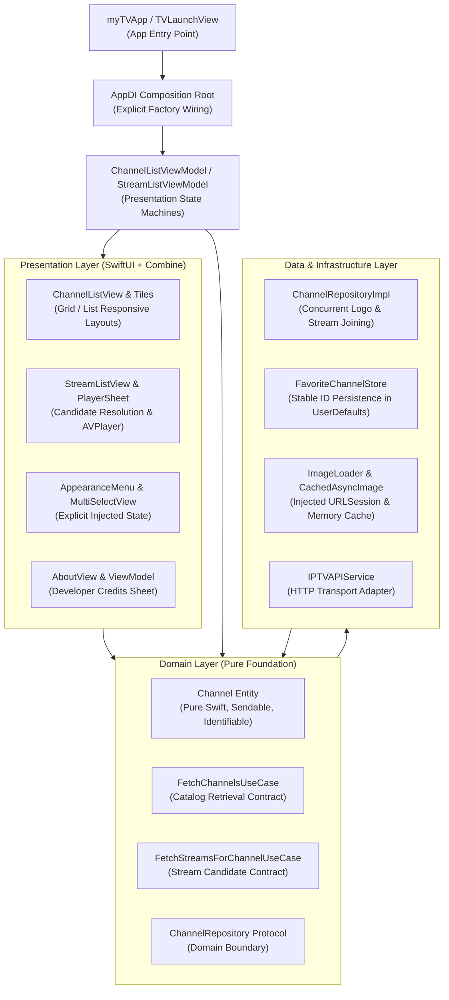
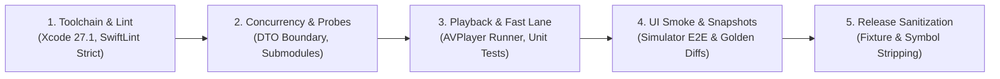
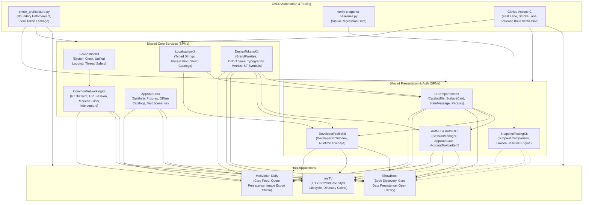

# myTV 📺

A modern, production-grade SwiftUI IPTV application focused on reactive catalog pipelines, clean domain boundaries, testable AVPlayer playback lifecycles, and explicit dependency injection.


Built by [Anurag Chourasia](https://github.com/Anurag-Chourasia), iOS Engineer. myTV browses public IPTV channel directories, applies reactive multi-criteria filtering and grouping, persists user favorites across relaunches, resolves stream candidates, and orchestrates live streaming through `AVPlayer`.

---

## 1. Executive Summary & Product Vision

myTV serves as an advanced architectural reference for high-throughput media catalog applications. It demonstrates:
- **Clean Domain Independence (IOS-73)**: Eliminates visual framework coupling from the core domain layer. `Channel` and associated domain entities are pure Swift/Foundation value types conforming to `Identifiable`, `Hashable`, and `Sendable`.
- **Explicit Presentation Composition (IOS-74)**: Controls and sheets (`AppearanceMenu`, `MultiSelectView`, `AboutView`) receive their dependencies explicitly from parent composition boundaries, completely eliminating singleton access from presentation controls.
- **Injected Image Transport & Lifecycle (IOS-75)**: `ImageLoader` accepts injected `URLSession` and `ImageCaching` instances with deterministic thread safety and test doubles, preventing unbounded memory growth.
- **Validated AVPlayer Playback Lifecycle (IOS-76)**: Playback candidate resolution, item observation, status validation, and error recovery operate under strict thread safety with verified identity checks that prevent stale playback races.

---

## 2. Architecture & Design Principles

myTV adheres to **Clean Architecture + MVVM** with a dedicated composition root (`AppDI`):



### Layer Breakdown:
1. **Presentation Layer (`myTV/Presentation/`)**:
   - Built with SwiftUI and Combine.
   - `ChannelListViewModel`: Employs a unified Combine pipeline combining search text, country/category filters, availability toggles, and section sorting into a single reactive output stream.
   - `StreamListViewModel`: Manages candidate stream indexing, AVPlayer item preparation, and automatic fallback sequencing.
2. **Domain Layer (`myTV/Domain/`)**:
   - `Domain/Entities/Channel.swift`: Pure Foundation entity; zero imports of SwiftUI or UIKit.
   - `Domain/UseCases/`: Isolated protocol contracts (`FetchChannelsUseCase`, `FetchStreamsForChannelUseCase`) defining business operations.
   - `Domain/Repositories/`: `ChannelRepository` protocol defining data contracts.
3. **Data Layer (`myTV/Data/`)**:
   - `ChannelRepositoryImpl`: Coordinates concurrent directory downloads, logo matching, and channel stream availability checks.
   - `FavoriteChannelStore`: Persists favorite channel IDs independently of downloaded directory caches.
4. **Composition Root (`myTV/App/AppDI.swift`)**:
   - Factory and dependency container that wires repositories, use cases, and image services into presentation models.

---

## 3. Shared SPM Package Integration

myTV integrates 8 shared Swift Packages:

| Package | Integration Role | Host Ingestion Seam |
|---|---|---|
| **DesignTokensKit** (`v1.22.3`) | Brand palette (`BrandPalette.myTV`), spacing, typography, and SF Symbols. | `myTV/Presentation/Components/` |
| **UIComponentsKit** (`v1.9.0`) | Composable `CatalogTile`, `StateMessage`, `TokenButtonStyle`, and layout menus. | `myTV/Presentation/Screens/ChannelList/` |
| **AuthKit & AuthKitUI** (`v0.8.0`) | Authentication state machine, profile sheet, and `AccountToolbarItem`. | `myTV/App/myTVApp.swift` |
| **FoundationKit** (`v0.2.0`) | System time abstractions and unified OS logging. | `myTV/Core/` |
| **LocalisationKit** (`v0.8.1`) | Localized channel categories, player state notices, and error alerts. | Throughout all ViewModels and Views |
| **CommonNetworkingKit** (`v2.0.0`) | Deterministic HTTP transport layer and redacting network logging. | `myTV/Data/Network/Services/IPTVAPIService.swift` |
| **DeveloperProfileKit** (`v1.2.0`) | In-app developer attribution and portfolio credits. | `myTV/Presentation/Screens/AboutView/` |
| **AppStubData** (`v1.0.0`) | Static IPTV channel and stream directory fixtures (`mytv-developer-catalog.json`). | `myTV/Developer/AppRuntime.swift` |
| **SnapshotTestingKit** (`v1.0.3`) | Visual regression testing against golden baseline references. | `myTVSnapshotTests/` |

---

## 4. Scripts, Tooling & Automation Catalog

All developer scripts and test runners are organized under `Scripts/` and `TestSupport/`:

| Script | Purpose & Rationale | Local Execution Command |
|---|---|---|
| `Scripts/bootstrap.sh` | Verifies submodule gitlinks, resolves exact pins, and builds Debug simulator binary. | `bash Scripts/bootstrap.sh` |
| `Scripts/check_design_tokens.py` | Scans all application Swift files verifying zero raw color literals or unregistered icons. | `python3 Scripts/check_design_tokens.py` |
| `Scripts/check_release_fixtures.py` | Validates that debug catalogs and test stubs are stripped from Release targets. | `python3 Scripts/check_release_fixtures.py` |
| `Scripts/test-fast.sh` | Executes Fast test lane (unit tests, adapter verification, use case logic). | `bash Scripts/test-fast.sh` |
| `Scripts/test-smoke.sh` | Executes UI Smoke test lane for critical user journeys (Catalog -> Stream -> Player). | `bash Scripts/test-smoke.sh` |
| `Scripts/test-snapshots.sh` | Runs pixel-by-pixel visual regression suite against pinned iPhone 11 simulator. | `bash Scripts/test-snapshots.sh` |
| `Scripts/verify-snapshot-baselines.py` | Enforces golden image baseline presence and blocks CI recording overrides. | `python3 Scripts/verify-snapshot-baselines.py` |
| `Scripts/verify-snapshot-boundary.py` | Guarantees snapshot test symbols are excluded from production binaries. | `bash Scripts/verify-snapshot-boundary.py` |
| `TestSupport/run-playback-tests.py` | Standalone runner validating AVPlayer item status callbacks and candidate advance logic. | `python3 TestSupport/run-playback-tests.py` |
| `TestSupport/run-channel-availability-tests.py` | Validates tri-state stream availability evaluation (`true` / `false` / `unknown`). | `python3 TestSupport/run-channel-availability-tests.py` |
| `TestSupport/run-favorites-tests.py` | Verifies favorite channel persistence across cold application relaunch cycles. | `python3 TestSupport/run-favorites-tests.py` |
| `TestSupport/check-actor-boundary.sh` | Compiles a strict concurrency probe verifying DTO actor boundary isolation. | `bash TestSupport/check-actor-boundary.sh` |

---

## 5. Continuous Integration & Quality Gates

The GitHub Actions CI pipeline (`.github/workflows/ci.yml`) enforces multi-tiered verification on every PR and push:



---

## 6. Local Setup & Contribution Guide

### Prerequisites:
- macOS Sonoma or Sequoia with **Xcode 27.1** installed (`/Applications/Xcode 27.1.app`).
- Python 3.10+ installed and on `PATH`.
- Pinned iPhone 11 Simulator installed.

### Step-by-Step Setup:
```sh
# 1. Clone repository
git clone https://github.com/Anurag-Chourasia/myTV.git
cd myTV

# 2. Bootstrap dependencies and build Debug simulator binary
DEVELOPER_DIR='/Applications/Xcode 27.1.app/Contents/Developer' bash Scripts/bootstrap.sh

# 3. Run fast unit test suite and playback validation
DEVELOPER_DIR='/Applications/Xcode 27.1.app/Contents/Developer' bash Scripts/test-fast.sh
python3 TestSupport/run-playback-tests.py

# 4. Run UI Smoke tests
DEVELOPER_DIR='/Applications/Xcode 27.1.app/Contents/Developer' bash Scripts/test-smoke.sh
```

---

## 7. End-to-End Ecosystem Connectivity



---

## 8. Canonical Notion Dashboards & Governance Links

- [iOS Portfolio — Engineering Tickets Dashboard](https://app.notion.com/p/c20d7f4b133b44499c8ac0b4d5f6249e?pvs=204)
- [iOS Portfolio — Master Document](https://app.notion.com/p/40ffa5f855b98192ad2ede66a5d36fe7)
- [Architecture Boundary Validator (`check_architecture.py`)](file:///Users/anuragchourasia/Desktop/Projects/UIComponentsKit/Scripts/check_architecture.py)
- [Release & Gate Policy Documentation (`Docs/MASTER.md`)](file:///Users/anuragchourasia/Desktop/Projects/Docs/MASTER.md)
